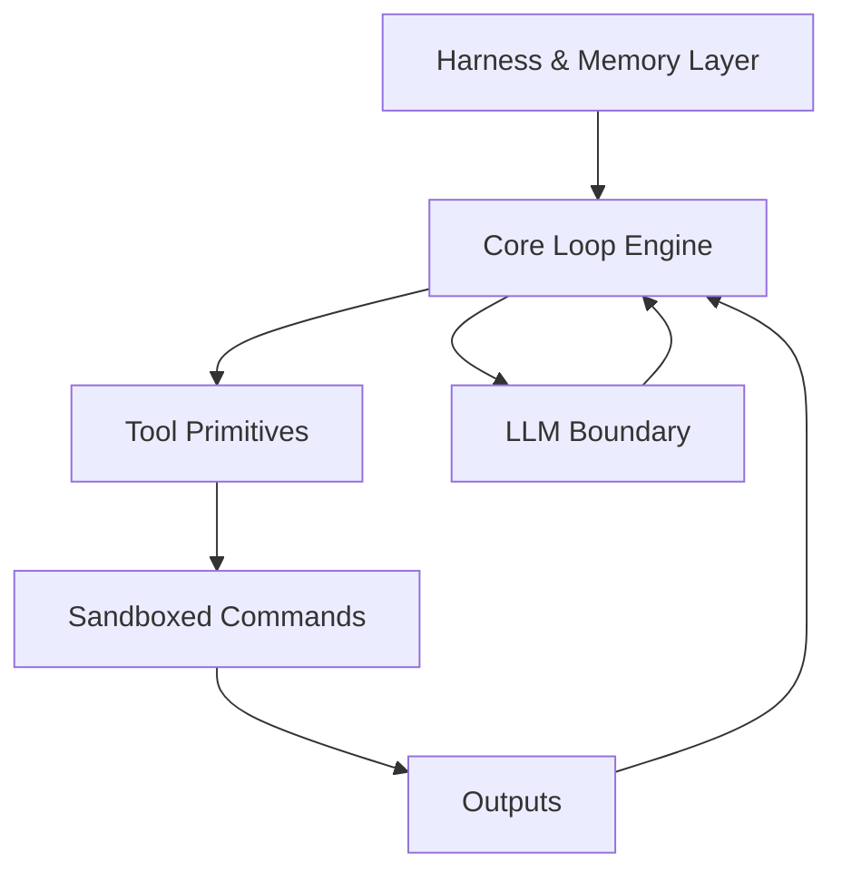

# Architecture Overview

**Pi‑Memo** isolates three layers:

1. **Harness & Memory Layer** – two‑stage compactor, dual‑layer experience bank, deterministic guards.
2. **Core Loop Engine** – Pi‑style `EventStream`‑driven turn loop that mediates between the LLM and the tool runner.
3. **Tool Primitives** – the four core actions (`read`, `write`, `edit`, `bash`).

---

## Diagram (Mermaid)

---

### Key Modules
- `src/core/types.ts` – shared type definitions.
- `src/core/event-stream.ts` – async push‑pull queue.
- `src/core/agent-loop.ts` – loop orchestration.
- `src/core/llm-boundary.ts` – stub LLM streaming (future plug‑in).
- `src/core/tool-runner.ts` – dispatches the four primitives.
- `src/tools/*` – implementations of `read`, `write`, `edit`, `bash`.
- `src/adapters/harbor-agent.ts` – placeholder for Harbor integration.

---

### Data Flow per Turn
1. **prepareRequest** – injects relevant rules from the dual‑layer memory.
2. **runLoop** – processes tool calls.
3. **prepareNextTurn** – runs two‑stage compaction, updates `CompactionState`.
4. **finishTurn** – verification gate decides whether the agent may emit an `end` event.

---

### Future Extensions
- Add a **Pattern Distiller** to promote episodic failures to global rules.
- Implement **Loop Detector** and **Verification Gate**.
- Hook into **Harbor** for benchmark evaluation.

┌────────────────────────────────────────────────────────────────────────────┐
│                        HARNESS & MEMORY LAYER (Your Diff)                  │
│  ┌──────────────────────┐  ┌─────────────────────┐  ┌───────────────────┐  │
│  │ Two-Stage Compactor  │  │ Dual-Layer Bank     │  │ Deterministic     │  │
│  │ 1. Rule-Based Elision│  │ E_t: Case Episodes  │  │ Guards            │  │
│  │ 2. Structured Handoff│  │ G_t: Distilled Rules│  │ - Loop Detector   │  │
│  │ (prepareNextTurn)    │  │ (Episodic->Proc.)   │  │ - Test/Lint Gate  │  │
│  └──────────┬───────────┘  └──────────┬──────────┘  └─────────┬─────────┘  │
└─────────────┼─────────────────────────┼───────────────────────┼────────────┘
              │                         │                       │
              ▼                         ▼                       ▼
┌────────────────────────────────────────────────────────────────────────────┐
│                     CORE LOOP ENGINE (Pi-Inspired)                         │
│  agentLoop / agentLoopContinue ──▶ EventStream<AgentEvent, AgentMessage[]> │
│         │                                                                  │
│         ▼                                                                  │
│  runLoop (Outer Follow-Up Loop + Inner Tool/Steering Loop)                 │
│    ├─ prepareNextTurn  ──▶ runs compaction & injects retrieved G_t rules   │
│    ├─ prepareRequest   ──▶ enforces token budget & model/thinking routing  │
│    ├─ streamAssistantResponse (transformContext -> convertToLlm boundary)  │
│    ├─ executeToolCalls (prepare -> beforeToolCall -> execute -> afterTool) │
│    └─ finishTurn       ──▶ runs verification gate before allowing "end"    │
└────────────────────────────────────────────────────────────────────────────┘